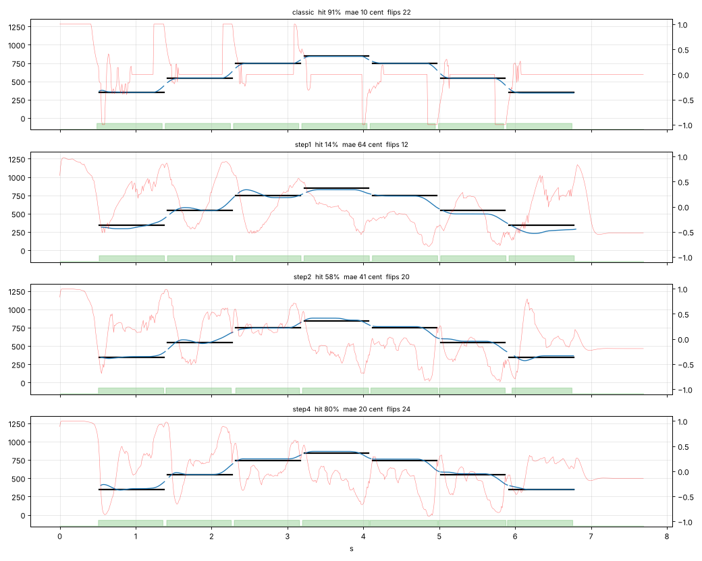

# classic — 比較用の古典制御（PID・観測器・規則の弁、NN なし）

学習した step（step1〜4）と比べるための、NN を 1 つも使わない決定論の演奏器。
`models/classic/` に step と同じ形で置いてあるので、**名前を選ぶだけで step と切り替えて比べられる**。

| 部分 | classic での担い手 |
|---|---|
| 耳 | YIN（step1・2 と同じ） |
| 目標の計画 | 楽譜の休符を次の音で埋め、移動にかかる時間だけ先回り（ツインの速さから） |
| 今どこにいるか | ツインのモーターの式に指令を入れて進める（推測航法）＋ 聞こえた音程で直す観測器 |
| アクチュエータ | 位置の **PID**（積分は目標の近くだけ・上限つき）、静止摩擦を飛び越す底上げ、ふらつきを止める保持帯 |
| 音程の微調整 | 音が落ち着いてから、聞こえた音程のずれを位置目標にゆっくり足す外側の積分 |
| 切換え弁 | 音の 3 ステップ前に開け、休符で閉める。音の頭では、プランジャーが近づくまで（最大 25 ステップ）待つ |

コード: [flute_rl/yamabiko/classic_numpy.py](../flute_rl/yamabiko/classic_numpy.py)（NumPy だけ。UNO Q でそのまま動く）。
`residual_numpy.runtime_for` が `classic.gains` を持つファイルにこのクラスを選ぶので、サーバー・評価スクリプトは変えていない。

## 1 ステップ（10 ms）の計算

```
x_ref = 位置(先回りした目標音程) + trim                  … ツインの閉管の式で音程 → 位置
e     = x_ref − x_est
u     = kp·e + ki·∫e − kd·v_est                            … ∫e は |e| < i_zone のときだけ、|ki∫e| ≤ i_max
pwm   = sign(u)·(band + (1 − band)|u|)                     … band は静止摩擦（動いているときは小さく）
        ただし |e| < hold_tol かつ遅いときは 0（hold_release を越えるまで保持）
x_est, v_est ← ツインのモーターの式に pwm を入れて 1 ステップ進める
（聞こえたら）x_est += observer_gain × (聞こえた音程の位置 − 数ステップ前の x_est)
（音が落ち着いたら）trim += pitch_ki × (目標 − 聞こえた音程) を位置に直した量
```

ゲインは `models/classic/profile.json` の `gains` に書いてある（中身は `classic_runtime.npz` と同じ）。

## 作り方

```bash
python scripts/yamabiko_classic_export.py                     # step4 のツイン、既定のゲイン → models/classic/
python scripts/yamabiko_classic_export.py --tune 120          # 先にシミュレーターでゲインを探す
python scripts/yamabiko_classic_export.py --twin runs/real/twin_y1f80_05_runtime.npz --set kp=15 ki=3
```

既定のゲインは、`--tune 120` と同じ手順（ツイン `twin_y1f80_04` の周りの 8 台、ドレミと音階）で探した値。
別の 16 台で確かめた誤差は 11.6 cent（探す前は 44 cent）。

## 比べ方

### シミュレーター（PC でも UNO Q でも、PyTorch なし）

```bash
python scripts/yamabiko_compare_sim.py --steps classic step1 step2 step4
python scripts/yamabiko_compare_sim.py --steps classic step4 --targets f80_doremi --rigs 16 --plot runs/compare
```

[flute_rl/yamabiko/sim_numpy.py](../flute_rl/yamabiko/sim_numpy.py) の機体は、ツインの式そのもの（PyTorch のシミュレーターと同じ式）で、
パラメーターをツインの周りにばらつかせ、ファン 80 % の設定と同じ不完全さを入れてある
（聞こえる音程は 2 ステップ前後遅れ、±3 cent の雑音、2 % の聞き逃し、モーターが動くと 2 割で聞こえない、弁は 3 ステップ遅れ、1250 cent より上は鳴らない）。
step4 のドレミの命中率は 80.3 % で、[step4.md](step4.md) の PyTorch のシミュレーターの値（80 %）と一致した。

**耳はシミュレートしていない**（どの step も同じように「遅れて雑音の入った本当の音程」を聞く）。比べているのは制御で、耳の違いは実機で比べる。

### 実機

```bash
UNOQ=ssh bash scripts/uno_q_push.sh          # models/classic/ も送られる
python scripts/yamabiko_step_eval.py --steps classic step4 --targets f80_doremi f80_scale f80_chromatic --repeats 2
```

ウェブ画面（口笛コピー）でも、step の一覧に classic が出る（既定は今までどおり最新の step）。

## 結果（シミュレーター、ツイン `twin_y1f80_04` の周りの 32 台、2026-11-24）

命中率は音の頭 0.3 秒を除いて ±25 cent 以内の割合、誤差は楽譜に音がある間の平均、反転は PWM の向きが変わった回数。

| 曲 | classic | step1 | step2・3 | step4 |
|---|---|---|---|---|
| ドレミファミレド | **90.6 %、10.5 cent**、反転 22 | 14.2 %、64.3 cent、反転 12 | 58.2 %、41.4 cent、反転 20 | 80.3 %、20.4 cent、反転 24 |
| 音階 | **82.9 %、13.7 cent**、反転 39 | 23.3 %、54.2 cent、反転 21 | 43.7 %、40.5 cent、反転 34 | 63.1 %、27.3 cent、反転 39 |
| 跳躍 | **45.2 %、121 cent**、反転 12 | 12.4 %、152 cent、反転 7 | 20.6 %、147 cent、反転 9 | 29.7 %、132 cent、反転 8 |

step2 と step3 はアクチュエータと弁が同じなので、耳をシミュレートしないここでは同じ数字になる。

図（各 step の 1 台目。黒が楽譜、青が鳴った音程、赤が PWM、緑が弁）:
[ドレミ](classic/f80_doremi.png)・[音階](classic/f80_scale.png)・[跳躍](classic/f80_leaps.png)



## 読み方の注意

- **このシミュレーターでは classic が有利。** 機体がツインの式そのもので、classic はその式を中に持っている（逆算も推測航法も式どおりに当たる）。
  NN の step も同じ形のシミュレーターで学んだが、式を直接は持っていない。実機は式から外れる（モーター音、非線形、日による違い）ので、**勝ち負けは実機で決める**。
- classic は音の間で一気に動いて止まり、保持帯で PWM を 0 にする。NN の step は PWM を細かく出し続ける（図の赤）。
  実機ではモーター音で音程が聞こえにくくなるので、この違いが効く可能性がある。
- 跳躍の曲は全員が苦手（短い音が大きく跳ぶ）。ゲインはドレミと音階で探したので、跳躍は探した範囲の外。
- 比較の目的は「NN が勝つこと」ではなく、全部 NN にしていく各段（[nn-e2e-plan.md](nn-e2e-plan.md)）で、**手で書いた制御に対してどこまで来たか**を同じ物差しで測ること。

## 2026-11-26 追記：classic_ear2（新しいツインでの調整と、練習＝反復学習制御）

[models/classic_ear2/](../models/classic_ear2/)。classic_ear と同じ古典制御（NN は耳だけ）に、2 つの改良を足した。

1. **ゲインを新しいツイン `twin_y1f80_05` で探し直した**（`--tune 80`、ドレミと音階、8 台）：kp 20 → 30、kd 0.72 → 1.43、保持帯を狭く、外側の積分を弱く、弁を開ける位置の幅を狭く。
   別の 16 台で誤差 12.9 → 10.8 cent
2. **練習（反復学習制御、ILC）**：1 回の演奏で、各時刻の聞こえた音程のずれ（位置に直して、聞こえの遅れの分だけ前の時刻に戻す）を記録し、
   同じ曲の次の演奏で、そのずれを 5 ステップでならして 14 ステップ先回りした分だけ、各時刻の位置の目標に足す（`ilc_gain` 1.0、上限 0.08 行程）。
   回を重ねるほど直しがたまる。NN の step7_practice の練習（前の回の記録を NN が読む）に当たる、古典制御の練習
3. 耳は ear_08（step8p2 と同じ）

シミュレーター（twin_05 の周りの 16 台、同じ機体で 3 回続けて、±25 cent 以内）：

| | 1 回目 | 2 回目 | 3 回目 |
|---|---|---|---|
| classic_ear | 0.709 | 0.708 | 0.707 |
| 新しいゲインだけ | 0.714 | 0.715 | 0.714 |
| **classic_ear2**（新しいゲイン＋練習） | 0.714 | **0.751** | **0.773**（ドレミ 0.95、音階 0.91、跳躍 0.46） |

練習の強さと先回りの探し方（強さ 0.3〜1.5、先回り 4〜20 ステップ）：先回り 20 では悪くなり、強さ 1.5 では跳躍が崩れた。
既定（`ilc_gain` 0）の classic・classic_ear は今までどおり練習しない。

```bash
python scripts/yamabiko_classic_export.py --twin runs/real/twin_y1f80_05_runtime.npz --tune 80 \
    --set ilc_gain=1.0 ilc_shift=14 ilc_smooth=5 --out runs/classic_tune/classic_ear2
```
