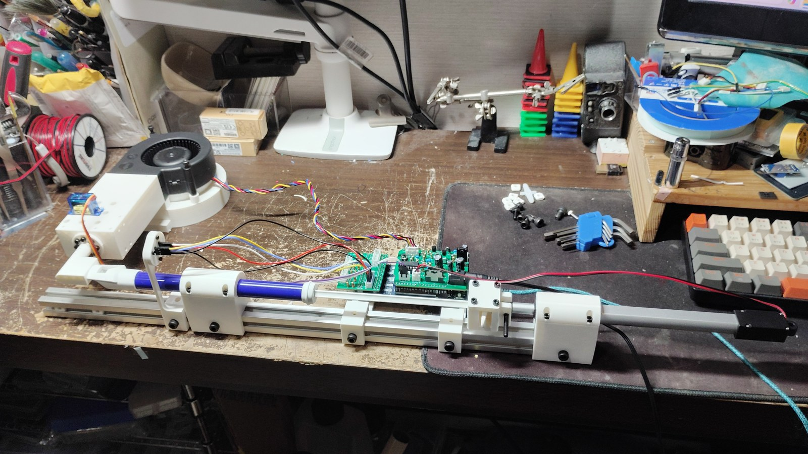
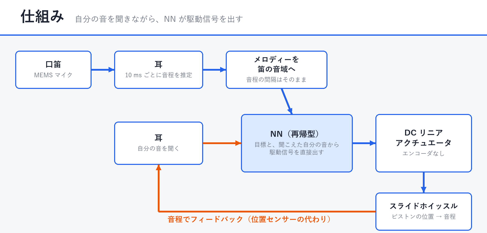
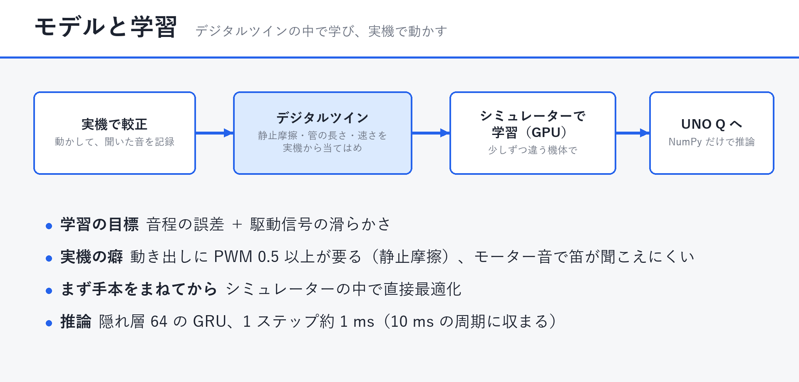
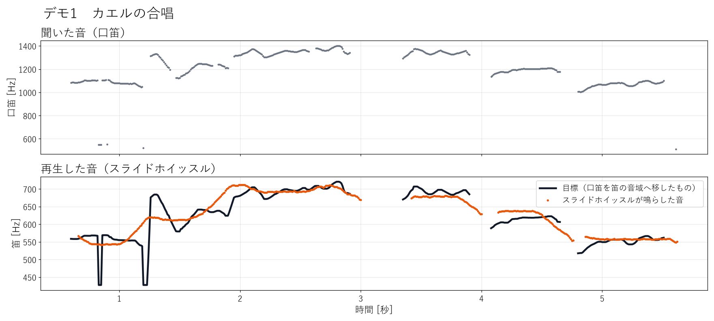

# やまびこ1号

## どんな装置？
人の口笛を聴き、スライドホイッスルでメロディーを吹き返すロボットです。遠心ファンで送風し、サーボで駆動する自作の切換え弁でタンギングを再現し、DCリニアアクチュエータで管体の中のピストンを動かして音程を変えます。

いちばんの特徴は、**DCリニアアクチュエータに位置センサー（エンコーダ）を付けず、笛の音の高さを位置の手掛かりにする**こと。自分が鳴らした音をMEMSマイクで聴いて、次の動きを直します。「聞いて返す」ので、名前はやまびこ1号です。

## 技術的な工夫
- **NNが駆動信号を直接出す**：再帰型ニューラルネットワーク（GRU）が、目標の音と、聞こえた自分の音を比べながら、DCリニアアクチュエータのPWMを10msごとに直接出力します。手書きのPD制御や位置の推定器は使わず、音程を合わせるフィードバックもNNが担います。
- **音程を位置センサーにする閉ループ**：エンコーダが無いため、聞こえた音程から位置を知り、音程によるフィードバック制御を同時に行います。
- **デジタルツインで学ぶ**：実機を短く動かして（較正：全行程で約14秒）、静止摩擦・管の長さ・速さを当てはめたデジタルツインを作り、その周りの少しずつ違う機体で、音程の誤差と駆動信号の滑らかさを同時に学習します。勾配はシミュレーターの中だけで使い、実機は動かすだけです。
- **相対的なメロディーコピー**：口笛のメロディーは、音程の間隔を保ったまま笛の音域へ移して吹きます。
- **Arduino UNO Qで役割分担**：Linux側で音程の推定（YIN）・NNの推論・口笛コピーとウェブ画面、MCU側でI2Sマイクの取り込み・PWM・サーボ信号・安全停止。NNはNumPyだけで動き、1ステップ約1msで10msの周期に収まります。

## 実機で分かったこと
- **静止摩擦が大きい**：DCリニアアクチュエータは|PWM| 0.5以下では動き出しません。従来の制御（PD制御＋位置の推定器）は、そのため細かく上下を繰り返していました（1曲で駆動信号の向きが250〜300回反転）。NNの制御では約10回で、滑らかに動きます。
- **送風の強さで音域が変わる**：ファン80%では裏返らずに、約430〜880Hzの1オクターブを使えます。
- **口笛コピーの成績（実機）**：ドレミファミレドで、隣り合う音の音程の誤差は13〜16 cent、音程が取れた割合は99%（100 cent＝半音）。カエルの合唱・うぐいす・スーパーマリオのデモで、聞いた口笛の形を写して吹いています。

上が聞いた口笛、下がスライドホイッスルで再生した音。黒い線の目標を、オレンジの点が追っています。

## 専用基板を2枚設計
KiCad 10で回路図・両面PCBを設計し、製造用ガーバーも作成しました。

- **A：ドライバーシールド（68.6×53.3mm）** — UNO QのR3ヘッダーに接続。TB6643KQによるDCリニアアクチュエータの駆動、ファン電源・PWM・回転数入力、サーボ用の6V電源と信号、演奏開始ボタンを搭載。
- **B：マイク子基板（40.7×53.3mm）** — UNO Breakout CarrierのJ14/J15に接続。ICS-43434をMCUのSAI1（3.3V）へ配線し、予備のMI2S0（1.8V）とI2C・GPIOも引き出します。

設計データをPythonで管理し、回路図・PCBを生成する方式です。生成時の記録では両基板ともERCエラー0、DRCエラー0、未接続0、回路図との不一致0でした（警告は別途記録）。外部との接続はXHコネクターを使います。

### 基板の設計画像

**A：ドライバーシールド**

**B：マイク子基板**

※KiCadのPCBデータから出力した3Dレンダリングです。一部の部品は3Dモデルを省略しています。実物ではA基板のヘッダーピンを下向きに出し、B基板のJ14/J15は裏面にメスソケットを実装します。

## BoM（主要部品／1台分）

|部品|数量|用途・仕様|
|---|---:|---|
|Arduino UNO Q|1|音程の推定・NNの推論・駆動制御|
|UNO Breakout Carrier（ASX00085）|1|マイク子基板の接続|
|Aドライバーシールド／Bマイク子基板|各1|専用製作PCB|
|DCリニアアクチュエータ|1|12V、位置センサーなし|
|BFB1012VH型 遠心ファン（ブロワー）|1|12V・4線式、送風用|
|SG90サーボ|1|自作の切換え弁の駆動（タンギング）|
|ICS-43434 MEMSマイクモジュール|1|I2S音声入力（口笛とスライドホイッスルの音程センシング）|
|スライドホイッスル（管体・ピストン）と機構|1式|可変管長の笛。機構を製作・調整|
|自作の切換え弁・ホース・継手・パッキン|1式|送風経路とタンギング|
|12V電源、UNO Q給電用USB電源・ケーブル|1式|駆動系と制御系への給電|
|基板実装部品・コネクター・配線・固定部品|1式|下記の基板BoM参照|

数量は1台分です。購入価格の記録がないため、価格・総額は掲載していません。弁のサーボは当初Feetech SCS0009（シリアル通信）でしたが、動作しなかったためSG90（PWM）に替えました。予備の電磁弁回路はDNP（必要になるまで実装しない）です。

## 現在地と、これから
**2026年11月、実機が完成し、Step1（NNが駆動信号を出し、口笛をまねて吹く）まで動きました。**

- **Step2**：タンギング（切換え弁のタイミング）をNNにします。
- **Step3**：音程を推定する耳をNNにします。20msの生の波形から音程を推定するNNを、実機の録音で学習中です。
- その後、耳・アクチュエータ・タンギングのNNを合わせて、全体を学び直します。

## 公開資料
- [計画・結果と操作できるシミュレーション](https://airpocket-soundman.github.io/chikuwa-flute-robot/yamabiko-plan.html)
- [学習の試行・音声比較レポート](https://airpocket-soundman.github.io/chikuwa-flute-robot/e2e-training-report.html)
- [ソースコード・KiCad設計・製造データ](https://github.com/airpocket-soundman/chikuwa-flute-robot)
- [Step1の紹介動画とデモ](https://github.com/airpocket-soundman/chikuwa-flute-robot/tree/main/media/step1)
